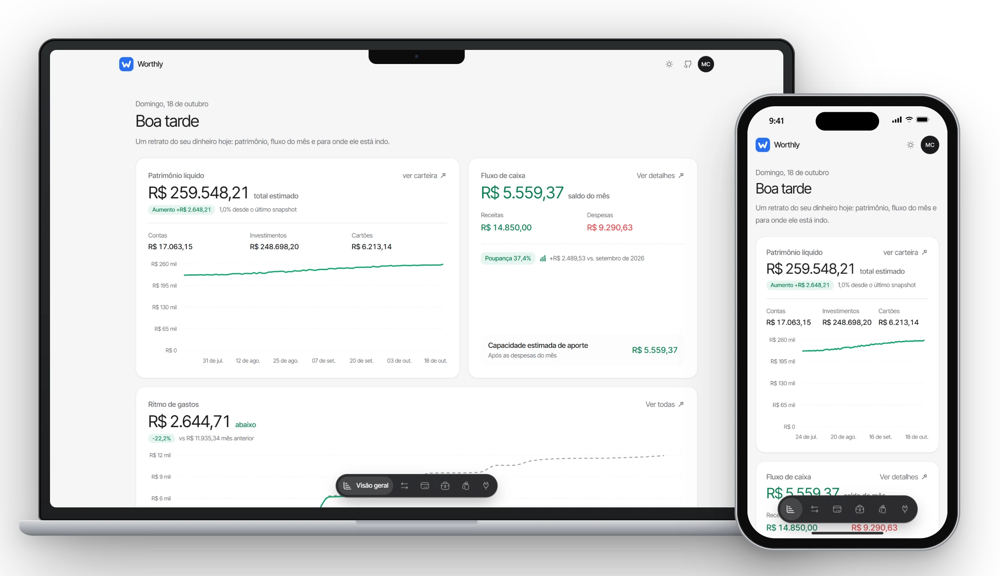
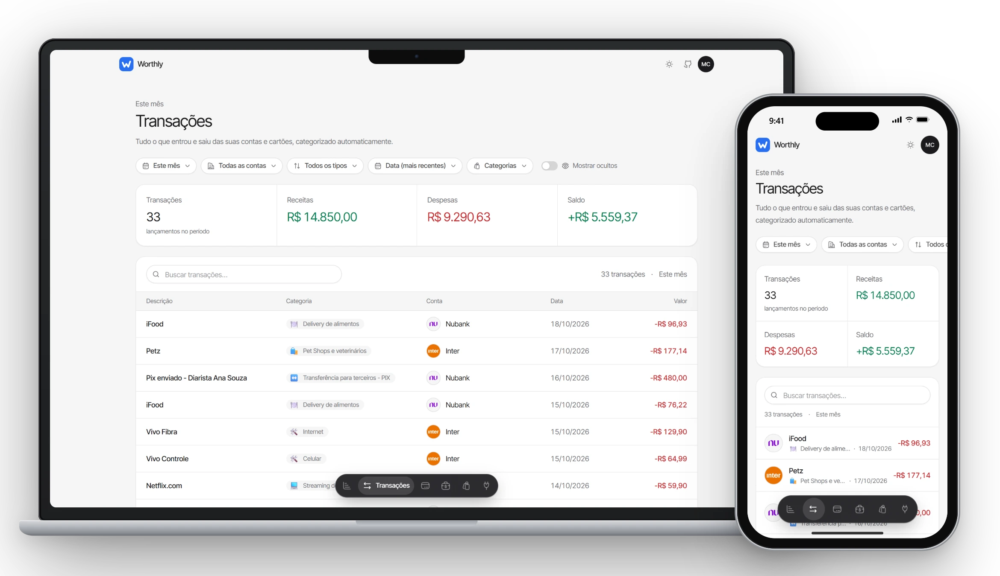
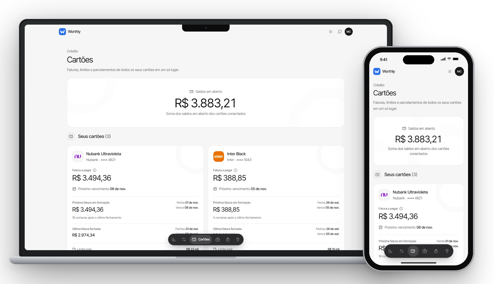
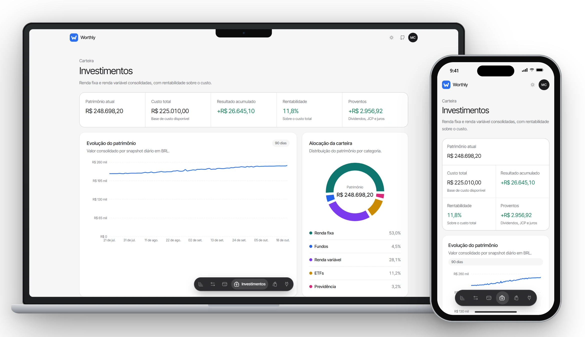
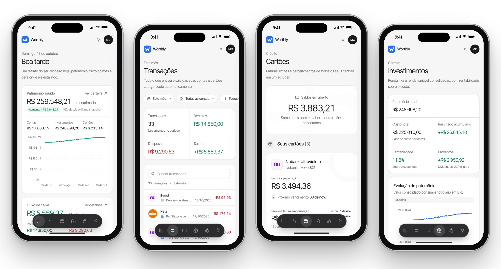
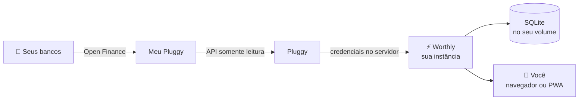

<div align="center">


# Worthly

**Suas finanças em um só lugar. Open source, no seu servidor, sem planilha.**

Contas, cartões, faturas e investimentos de todos os seus bancos, lidos via Open Finance e organizados em um painel bonito e rápido.

<br />

[](https://tryhangar.io/deploy?repo=https://github.com/csbills/worthly)

<sub>Sua instância no ar em poucos minutos, com HTTPS, banco persistente e migrations automáticas. Sem configurar servidor.</sub>

<br />


[Funcionalidades](#-funcionalidades) · [Telas](#-telas) · [Deploy](#-suba-sua-instância) · [Como funciona](#-como-funciona) · [Rodando localmente](#-rodando-localmente) · [Contribuindo](#-contribuindo)

<br />

<picture>
  <source media="(prefers-color-scheme: dark)" srcset="docs/screenshots/hero-dark.webp" />
  
</picture>

</div>

---

## ✨ Funcionalidades

|  |  |
| --- | --- |
| 📊 **Painel completo** | Patrimônio líquido, fluxo de caixa, ritmo de gastos do mês e evolução ao longo do tempo. |
| 💳 **Cartões e faturas** | Faturas, limite usado e disponível, e parcelamentos acompanhados de perto. |
| 🧾 **Transações** | Lista com busca, filtros e categorias, pensada para funcionar bem no celular. |
| 📈 **Investimentos** | Carteira consolidada das suas corretoras e bancos, com alocação, rentabilidade e proventos. |
| 🔐 **Face ID e biometria** | Login sem senha com passkeys e bloqueio do app quando ele fica em segundo plano. |
| 📱 **Instala como app** | PWA no iPhone, Android e desktop, sem passar por loja. |
| 🛡️ **Somente leitura** | O Worthly só consulta saldos e lançamentos. Nenhum dinheiro é movimentado. |
| 🏠 **Seus dados, sua instância** | Credenciais e banco de dados ficam no servidor que você controla. Nada passa por terceiros além do seu banco e da Pluggy. |

## 📸 Telas

<sub>Dados fictícios do [modo demo](#modo-demo). As imagens acompanham o tema claro ou escuro do seu GitHub.</sub>

### Transações

Busca, filtros por período, conta e categoria, e categorização automática de tudo o que entrou e saiu.

<picture>
  <source media="(prefers-color-scheme: dark)" srcset="docs/screenshots/transactions-dark.webp" />
  
</picture>

### Cartões e faturas

Fatura a pagar, próxima fatura em formação, última fatura fechada e limite de cada cartão.

<picture>
  <source media="(prefers-color-scheme: dark)" srcset="docs/screenshots/cards-dark.webp" />
  
</picture>

### Investimentos

Patrimônio, custo, rentabilidade, proventos, evolução em 90 dias e alocação por categoria.

<picture>
  <source media="(prefers-color-scheme: dark)" srcset="docs/screenshots/investments-dark.webp" />
  
</picture>

### No celular, como app

Instalado como PWA, o Worthly ocupa a tela inteira e navega por uma barra de abas na parte de baixo.

<picture>
  <source media="(prefers-color-scheme: dark)" srcset="docs/screenshots/phones-dark.webp" />
  
</picture>

## 🚀 Suba sua instância

O jeito mais rápido (e o que a gente usa e recomenda) é o **Hangar**:

[](https://tryhangar.io/deploy?repo=https://github.com/csbills/worthly)

1. **Clique no botão.** O Hangar lê o [`hangar.yaml`](hangar.yaml) deste repositório e mostra o que vai criar antes de começar.
2. **Revise o que será criado.** Nenhuma chave é pedida no deploy: as credenciais da Pluggy são coladas depois, no onboarding.
3. **Confirme.** O Hangar faz o build, cria o volume persistente em `/data`, configura o domínio com HTTPS e publica.
4. **Abra a URL**, crie sua conta e siga o onboarding em `/onboarding`.

O `hangar.yaml` já resolve o que costuma dar trabalho num deploy manual:

- **Volume persistente** para o SQLite (`DATABASE_URL=file:/data/worthly.db`). Seus dados sobrevivem a todo deploy.
- **Migrations automáticas**: o `npm start` roda `prisma migrate deploy` antes de subir o Next.js.
- **`APP_URL` preenchida** com o endereço HTTPS da instância, que é o que o Face ID e a biometria precisam.
- **Deploy a cada push**: atualizar sua instância é só dar `git pull` no seu fork e enviar.

> [!TIP]
> Faça um fork antes de clicar no botão (troque `csbills/worthly` pelo seu repositório no link). Assim você controla quando puxar novidades daqui e pode personalizar o app à vontade.

<details>
<summary><b>Prefere hospedar em outro lugar?</b></summary>

<br />

O Worthly é um app Next.js comum e roda em qualquer host Node.js com disco persistente:

1. Defina `DATABASE_URL` apontando para um arquivo num volume persistente, por exemplo `file:/data/worthly.db`. Sem volume, o SQLite é recriado a cada deploy e você perde suas conexões.
2. Defina `APP_URL` com a URL pública da instância.
3. Rode `npm run build` e depois `npm start`.
4. Mantenha **uma única réplica**, porque o SQLite não é compartilhado entre instâncias.

</details>

## 🧭 Como funciona



O [Meu Pluggy](https://meu.pluggy.ai) conecta seus bancos pelo Open Finance de graça. O Worthly usa a API da Pluggy, com credenciais que ficam **só no servidor**, para ler contas, faturas, transações e investimentos, e monta o painel a partir daí.

### O onboarding

Na primeira vez, o fluxo em `/onboarding` guia cada etapa e valida tudo o que você cola:

| Etapa | O que você faz | O que o Worthly faz |
| --- | --- | --- |
| **1. Meu Pluggy** | Cria a conta grátis em [meu.pluggy.ai](https://meu.pluggy.ai) e conecta seus bancos pelo Open Finance. | — |
| **2. Credenciais** | Cria uma conta em [dashboard.pluggy.ai](https://dashboard.pluggy.ai) (teste de 15 dias), adiciona o conector **MeuPluggy**, cria uma aplicação *Development* e cola o **Client ID** e o **Client Secret**. | Valida o par com a API da Pluggy antes de salvar no servidor. |
| **3. Item ID** | Na aplicação, clica em **Ir para Demo**, conecta o MeuPluggy, escolhe o banco e usa **⋯ → Copiar Item ID**. Repete para cada banco. | Confere o item na Pluggy e identifica o banco. |
| **4. Pronto** | Abre o painel. | Lê contas, faturas, transações e investimentos. |

Mais detalhes no guia oficial: [pluggyai/meu-pluggy](https://github.com/pluggyai/meu-pluggy).

### Conta e segurança

No primeiro acesso, a instância pede **nome, sobrenome, e-mail e senha** para criar a conta da pessoa dona. Depois disso o cadastro é fechado e só existe login.

- Senhas guardadas com scrypt e sal aleatório, nunca em texto puro.
- Sessões no banco, com cookie `httpOnly` e `SameSite=Lax`, válidas por 30 dias e renovadas com o uso.
- Toda página e toda Server Action verificam a sessão no servidor. O Proxy só faz a checagem rápida do cookie.
- Bloqueio de 15 minutos depois de 5 tentativas de login erradas.

### Face ID e biometria

Em **Segurança** (menu do avatar), ative uma chave de acesso (passkey/WebAuthn) no aparelho. A partir daí:

- O login ganha **Entrar com Face ID** (Touch ID no Mac, biometria no Android, Windows Hello no PC), sem digitar e-mail nem senha.
- O app passa a ter **bloqueio**: depois de 5 minutos em segundo plano, pede Face ID ou biometria para abrir de novo. A senha continua valendo como alternativa.
- Só a chave pública fica no banco. A privada nunca sai do aparelho, e chaves sincronizadas (iCloud Keychain, Gerenciador de Senhas do Google) já aparecem nos seus outros aparelhos.

> [!IMPORTANT]
> As chaves ficam presas ao domínio da instância. Em produção, defina `APP_URL` e não troque de domínio depois. O navegador só oferece chaves de acesso em HTTPS ou em `localhost`.

### Instale como app

O Worthly é um PWA. No Android/Chrome, use **Instalar app** no menu do avatar. No iPhone, **Compartilhar → Adicionar à Tela de Início**. Os dados financeiros nunca ficam em cache no aparelho: offline, o app mostra apenas um aviso.

## 💻 Rodando localmente

Você precisa de Node.js 20 ou mais recente.

```bash
git clone https://github.com/csbills/worthly.git
cd worthly
npm install
cp .env.example .env
npm run db:migrate
npm run dev
```

Abra [http://localhost:3000](http://localhost:3000), crie sua conta e siga o onboarding.

### Modo demo

Quer ver o app funcionando sem conectar um banco? O modo demo troca a Pluggy por dados fictícios (três bancos, cartões com parcelamentos e uma carteira de investimentos) e usa um banco separado em `prisma/demo.db`, sem tocar no seu `dev.db`:

```bash
npm run demo
```

Abra [http://localhost:3100](http://localhost:3100) e entre com `demo@worthly.test` / `worthly-demo`. Para recriar só o banco demo, rode `npm run demo:seed`. Foi com ele que as imagens deste README foram geradas.

### Variáveis de ambiente

| Variável | Obrigatória | Descrição |
| --- | --- | --- |
| `DATABASE_URL` | Não | Caminho do SQLite. Padrão: `file:./prisma/dev.db`. Em produção, aponte para um volume persistente. |
| `WORTHLY_DEMO` | Não | Com `1`, usa dados fictícios no lugar da Pluggy. O `npm run demo` já define. |
| `APP_URL` | Em produção | URL pública da instância (ex.: `https://financas.exemplo.com`). Define o domínio das chaves de acesso. Localmente, o host da requisição é usado. |

As credenciais da Pluggy são configuradas no onboarding, ficam só no banco do servidor e nunca vão para o navegador.

### Scripts

| Comando | O que faz |
| --- | --- |
| `npm run dev` | Servidor de desenvolvimento |
| `npm run build` | Gera o Prisma Client e faz o build de produção |
| `npm start` | Aplica as migrations pendentes e sobe o servidor |
| `npm test` | Testes (Vitest) |
| `npm run lint` | Lint e formatação (Biome) |
| `npm run demo` | Sobe o app com dados fictícios em `localhost:3100` |
| `npm run db:migrate` | Cria e aplica migrations em desenvolvimento |
| `npm run db:studio` | Abre o Prisma Studio |

### Stack

[Next.js 16](https://nextjs.org) (App Router, Server Components e Server Actions) · [React 19](https://react.dev) · [Tailwind CSS 4](https://tailwindcss.com) · [Base UI](https://base-ui.com) · [Prisma 7](https://www.prisma.io) + SQLite · [Recharts](https://recharts.org) · [Pluggy SDK](https://docs.pluggy.ai) · [SimpleWebAuthn](https://simplewebauthn.dev)

## 🤝 Contribuindo

O Worthly é feito pela comunidade, e **PRs com novas funcionalidades são muito bem-vindos**. Algumas ideias se você quiser começar:

- 🎯 Metas e orçamentos por categoria
- 🔔 Alertas de fatura fechando, gasto fora do padrão e saldo baixo
- 🏷️ Regras automáticas de categorização
- 📤 Exportação para CSV e planilhas
- 👥 Múltiplos usuários por instância (finanças do casal ou da família)
- 🌎 Tradução para outros idiomas

Tem outra ideia? [Abra uma issue](https://github.com/csbills/worthly/issues/new) para a gente conversar antes de você investir tempo nela.

### Como enviar um PR

1. Faça um fork e crie uma branch a partir da `main` (`git checkout -b feat/minha-ideia`).
2. Escreva testes para o comportamento novo sempre que der.
3. Siga a arquitetura do projeto: Server Components por padrão, dados buscados com Server Actions, e credenciais, Prisma e chamadas externas só no servidor.
4. Mudou o `prisma/schema.prisma`? Gere uma migration com `npm run db:migrate`.
5. Antes de abrir o PR, rode:

   ```bash
   npm test && npm run lint && npm run build
   ```

6. Descreva o que mudou e, se for visual, anexe um print (do desktop e do celular).

> [!TIP]
> Quer mostrar sua feature funcionando de verdade? Suba seu fork no [Hangar](https://tryhangar.io) e coloque o link no PR. Fica muito mais fácil de revisar.

---

<div align="center">

<sub>Feito com ☕ no Brasil · Hospedado com ❤️ no <a href="https://tryhangar.io">Hangar</a></sub>

<br />

[](https://tryhangar.io/deploy?repo=https://github.com/csbills/worthly)

</div>
